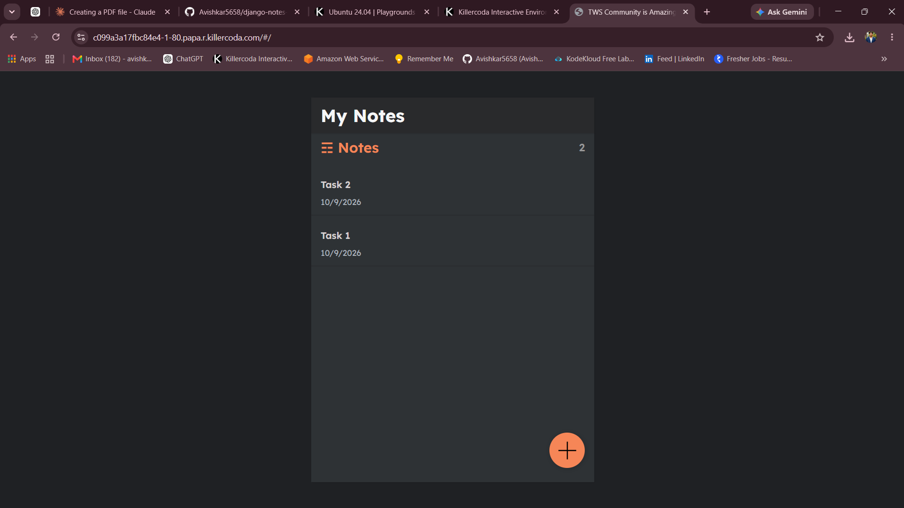
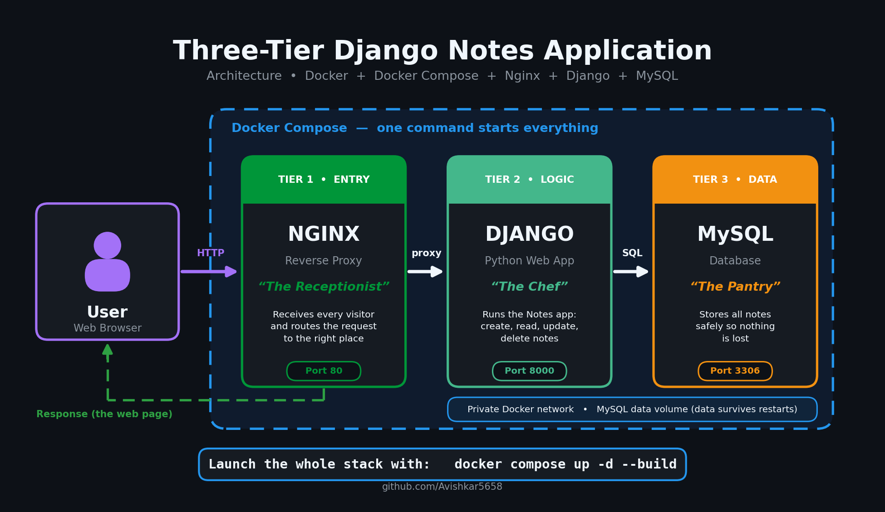
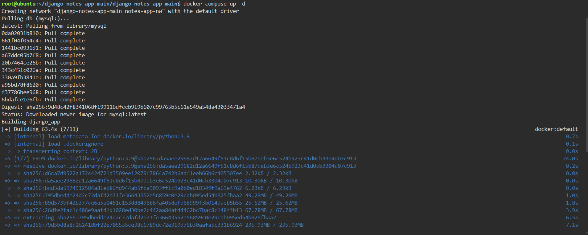
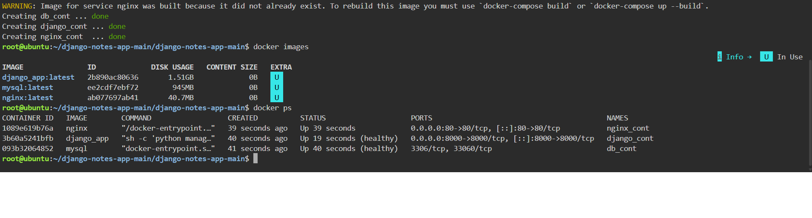

<div align="center">

# 🐳 Three-Tier Django Notes Application

### Run a complete web application with **one command**: no manual setup, no "it works on my machine."


<br>



<sub>👆 <b>The finished result:</b> a working Notes app, started with a single command.</sub>

</div>

---

## 📑 Table of Contents

1. [The Problem](#-the-problem-in-plain-english)
2. [The Solution](#-the-solution)
3. [Architecture](#-architecture)
4. [Technologies Used and Why](#-technologies-used-and-why)
5. [How a Request Flows](#-how-a-request-flows)
6. [Demo and Screenshots](#-demo-and-screenshots)
7. [Step-by-Step Implementation](#-step-by-step-implementation)
8. [Troubleshooting](#-troubleshooting)
9. [Challenges and What I Learned](#-challenges-and-what-i-learned)
10. [Cleanup](#-cleanup)
11. [Future Improvements](#-future-improvements)
12. [Use This Project](#-use-this-project-in-your-own-repo)

---

## 🤔 The Problem (in plain English)

Imagine a developer builds a web app on their laptop. It works perfectly. Then they hand it to a teammate or put it on a server, and suddenly:

- 😟 "It doesn't work on my machine"
- 😟 The wrong version of a tool is installed
- 😟 Setting up the app, the web server and the database takes **hours** of careful steps
- 😟 One small mistake and nothing starts

Companies can't afford this. They need apps that start **the same way, every time, on every computer.**

## 💡 The Solution

This project shows **how it's done**, using **Docker**. Docker puts each part of the app into its own sealed box, called a **container**, with everything it needs already inside. **Docker Compose** then starts all the boxes together with one command.

> 🍽️ **Restaurant analogy**
>
> A restaurant has three people, and each does one job:
>
> - 🛎️ **The Receptionist (Nginx)** greets every guest and sends them to the right place.
> - 👨‍🍳 **The Chef (Django)** prepares what the guest asked for. Here, the chef creates, shows, edits and deletes notes.
> - 🥫 **The Pantry (MySQL)** stores everything safely, so nothing is lost when the restaurant closes for the night.
>
> Docker keeps each person in their own room. Docker Compose **opens the whole restaurant at once.**

| Term | Simple meaning |
|------|----------------|
| 📦 **Container** | A sealed box holding one part of the app and everything it needs to run |
| 🐳 **Docker** | The tool that builds and runs containers |
| 🎼 **Docker Compose** | The tool that starts many containers together and connects them |
| 🛎️ **Reverse Proxy (Nginx)** | The "receptionist" that receives visitors and passes them to the app |
| 🧠 **Django** | A popular Python framework used to build the web app |
| 🗄️ **Database (MySQL)** | The place where all notes are stored |
| 🧱 **Three-tier** | Three layers, each with one job: entry, logic, data |

### ✅ Result

**A full web application, started in about a minute with a single command, identical on every computer.**

---

## 🏗️ Architecture

<div align="center">
  
</div>

**How to read the diagram (follow the arrows):**

1. 👤 A **user** types the website address in a browser.
2. 🛎️ **Nginx** (Tier 1) receives the request first. It is the only part visitors talk to.
3. 👨‍🍳 Nginx passes it to **Django** (Tier 2), which runs the Notes app.
4. 🥫 When Django needs to save or read a note, it asks **MySQL** (Tier 3).
5. 🔙 The answer travels back the same way, and the user sees the page.

All three run in separate containers on a **private Docker network**, and the MySQL data is kept in a **volume**, so notes survive a restart.

---

## 🧰 Technologies Used and Why

| Technology | What it is (simple) | Why it's used here |
|------------|---------------------|--------------------|
| **Docker** | A tool that packs software into containers | Makes the app run the same everywhere |
| **Dockerfile** | A recipe for building one container | Builds the Django app image step by step |
| **Docker Compose** | A tool to run several containers together | Starts Nginx, Django and MySQL with one command |
| **Nginx** | A fast web server | Acts as the reverse proxy in front of the app |
| **Django (Python)** | A web application framework | Runs the Notes app logic |
| **MySQL** | A database | Stores the notes permanently |
| **Docker Network** | A private network for containers | Lets the three containers talk to each other safely |
| **Docker Volume** | A storage area outside the container | Keeps the database data after restarts |

---

## 🔄 How a Request Flows

What happens when you click **"Save note"**:

| Step | Who | What happens |
|:----:|-----|--------------|
| **1** | 👤 You | Click **Save** in the browser |
| **2** | 🛎️ Nginx | Receives the request and forwards it to Django |
| **3** | 👨‍🍳 Django | Checks the note and prepares it for storage |
| **4** | 🥫 MySQL | Saves the note in the database |
| **5** | 👨‍🍳 Django | Builds the updated page with your new note |
| **6** | 🛎️ Nginx → 👤 You | The page comes back and you see your note ✅ |

---

## 📸 Demo and Screenshots

### 🔨 Step 1: Docker Compose builds everything

One command builds the images and prepares all the containers.

<div align="center">
  
</div>

### ✅ Step 2: All three containers are running

Each tier runs in its own container. All of them show as **Up** ✅

<div align="center">
  
</div>

### 🌐 Step 3: The app works in the browser

<div align="center">
  
</div>

---

## 🛠️ Step-by-Step Implementation

> 💻 **Works on:** Windows, macOS and Linux, anywhere Docker runs.
>
> ✏️ *Check that the ports and file names below match your `docker-compose.yml`.*

### ✅ Prerequisites

- **Git** to download the project: [install Git](https://git-scm.com/downloads)
- **Docker Desktop** (Windows/macOS) or **Docker Engine + Compose** (Linux): [install Docker](https://docs.docker.com/get-docker/)
- About **2 GB of free disk space** and an internet connection for the first build

Check that both are installed:

```bash
git --version
docker --version
docker compose version
```

---

### Step 1️⃣ — Download the project

```bash
git clone https://github.com/Avishkar5658/django-notes-app-main.git
cd django-notes-app-main
```

---

### Step 2️⃣ — Build and start all three containers

```bash
docker compose up -d --build
```

| Part of the command | Meaning |
|---------------------|---------|
| `docker compose up` | Create and start everything defined in `docker-compose.yml` |
| `-d` | Run in the background, so your terminal stays free |
| `--build` | Build the images first (the first time takes a few minutes) |

---

### Step 3️⃣ — Check that everything is running

```bash
docker compose ps
```

You should see **three containers** (Nginx, Django, MySQL) with the status **Up** ✅ (compare with the screenshot above).

---

### Step 4️⃣ — Open the app 🎉

Go to **http://localhost** in your browser and start creating notes.

> ℹ️ If your project uses a different port, use that one, for example `http://localhost:8000`.

---

### Step 5️⃣ — Look inside (optional, great for learning)

```bash
docker compose logs -f           # watch live logs from all containers
docker compose logs django       # logs from one service only
docker compose exec django bash  # open a shell inside the Django container
```

> ✏️ Replace `django` with your actual service name from `docker-compose.yml`.

---

## 🔧 Troubleshooting

| Problem | Likely cause | Fix |
|---------|--------------|-----|
| `port is already allocated` | Another program uses that port | Stop it, or change the port mapping in `docker-compose.yml` |
| Page shows **502 Bad Gateway** | Django is still starting | Wait 20 to 30 seconds and refresh |
| Django can't connect to the database | MySQL needs time to start | Run `docker compose restart` after a short wait |
| Code changes don't appear | The image wasn't rebuilt | Run `docker compose up -d --build` |
| `docker: command not found` | Docker isn't installed or running | Install Docker and make sure Docker Desktop is open |
| Something else is wrong | Unknown | Read the logs: `docker compose logs -f` |

---

## 🎓 Challenges and What I Learned

> ✏️ *Replace the rows below with problems you actually faced. Genuine lessons stand out the most.*

| Challenge | How I solved it |
|-----------|-----------------|
| Django started before MySQL was ready | Read the logs, then added a wait/restart so the database was ready first |
| Nginx showed **502 Bad Gateway** | Fixed the proxy address in the Nginx config so it pointed to the Django container |
| Containers couldn't reach each other | Learned that Compose services talk to each other by **service name**, not `localhost` |

**Key takeaways**

- ✅ How **containers** make an app portable and repeatable
- ✅ How **Docker Compose** connects multiple services with one file
- ✅ How a **reverse proxy** sits in front of an application
- ✅ How **volumes** keep database data safe
- ✅ How to **debug** containers with logs and shell access

---

## 🧹 Cleanup

This project runs on your own computer, so it is **free**. Stop it when you are done:

```bash
docker compose down        # stop and remove the containers
docker compose down -v     # also delete the database volume (your notes will be erased)
```

> ⚠️ `down -v` permanently deletes the stored notes. Use it only when you want a fresh start.

---

## 🔮 Future Improvements

- [ ] ❤️ Add **health checks** and `restart: unless-stopped` to each service
- [ ] 🔐 Move passwords into a **`.env` file** (never commit real secrets)
- [ ] 🤖 Add a **GitHub Actions** pipeline that builds the image on every push
- [ ] 📦 Publish the image to **Docker Hub** or **AWS ECR**
- [ ] ☁️ Deploy it to **AWS** (EC2, then ECS)
- [ ] 🔒 Add **HTTPS** to Nginx

---

## 🔁 Use This Project in Your Own Repo

Want to try it or add it to your own portfolio?

1. **Fork** this repository (top-right button) or download it as a ZIP
2. Follow the [step-by-step guide](#-step-by-step-implementation) on your own computer
3. Replace the screenshots in `screenshots/` with **your own**
4. Customize the app (title, colors, text, an extra note field)
5. Write your own **Challenges and What I Learned** section
6. ⭐ If it helped you, give the repo a star!

### 💡 Ideas to make it your own

- Change the app title and colors
- Add a new field to a note (for example, a category or a date)
- Add a health check to each container
- Deploy it to a cloud server

### 📁 Repository structure

> ✏️ *Edit this tree so it matches your real files.*

```
django-notes-app/
├── README.md
├── Dockerfile               # Recipe for the Django container
├── docker-compose.yml       # Starts and connects all three containers
├── nginx/
│   └── default.conf         # Reverse proxy settings
├── requirements.txt         # Python packages
├── manage.py                # Django entry point
└── screenshots/
    ├── architecture.png
    ├── docker-compose-build.png
    ├── containers-running.png
    └── django-notes-app.png
```

---

## 👤 Author

**Avishkar Thorave**

[](https://github.com/Avishkar5658)
[](https://www.linkedin.com/in/avishkar-thorve-a77a8b2a1)

> ✏️ *If this is based on an open-source Django notes app, add a credit line here, such as "Based on the original project by [name](link)." Then describe what you added yourself.*

---

<div align="center">

⭐ **If you found this useful, give it a star!** ⭐

*Built with 🐳 Docker and a lot of curiosity.*

</div>
